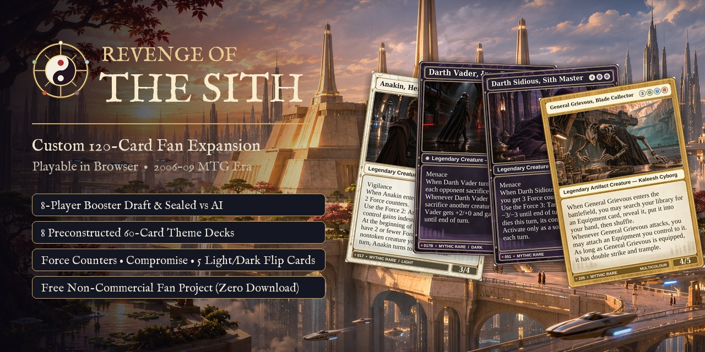
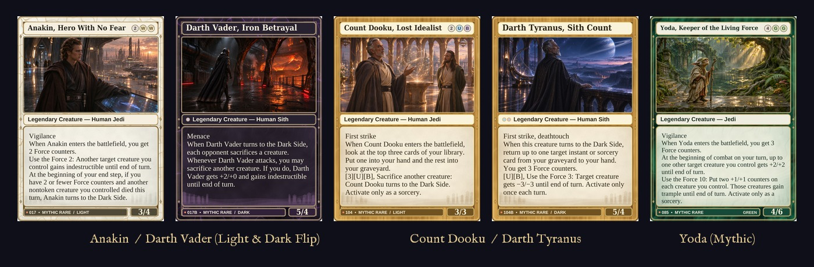
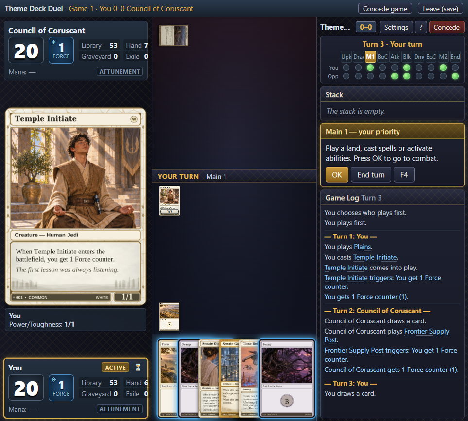

  

<h1 align="center">Revenge of the Sith — Fan Set Client</h1>

  <b>A free, browser-playable 120-card custom Magic expansion inspired by 2006–09 MTG design &amp; <i>Star Wars</i>.</b> 
  No account, no installation, no build step — draft against 7 AI players, duel 8 preconstructed theme decks, or play friends online.

  <a href="https://liakias-web.github.io/revenge-of-the-sith-mtg/"><b>▶ Play Now in Your Browser</b></a>
  &nbsp;&nbsp;•&nbsp;&nbsp;
  <a href="https://github.com/Liakias-web/revenge-of-the-sith-mtg/releases/latest"><b>⬇ Download Windows Edition (.zip)</b></a>
  &nbsp;&nbsp;•&nbsp;&nbsp;
  <a href="NOTICE.md"><b>Fan Work &amp; AI Disclosure</b></a>

> **Unofficial, non-commercial fan work:** Created purely for personal enjoyment and nostalgia for 2006–09-era Limited/Constructed Magic (*Time Spiral* / *Lorwyn* / *Alara* power level) combined with *Star Wars*. Built with AI assistance (illustrations, engine scripting, and playtest simulation). Uses custom mana/tap symbols and original **Porcelain & Gilt** card frames. Not affiliated with or endorsed by Wizards of the Coast or Lucasfilm. See [NOTICE.md](NOTICE.md).

---

## Visual Preview

### Porcelain & Gilt Cards &amp; Light/Dark Side Flip Cards

  

### MTGO-Style Game Table (Force Counters, Attunement &amp; Full Rules Engine)

  

---

## What's Inside

* **120-Card Small Expansion (125 Card Faces + 5 Basic Lands + 4 Tokens):** Designed as the small follow-up expansion to *The Old Republic* fan block, targeting the 2006–09 power level and design ethos (Mythic Rares included, no Planeswalkers).
* **Set Mechanics:**
  * **Force Counters &amp; *Use the Force N*:** Bank Force counters across turns (similar to Energy) and spend them on activated abilities and kicker-like payoffs.
  * **Compromise N:** *"Give an opponent N Force counters, or lose N life"* — signature White/Black mechanic capturing the Republic's political erosion.
  * **Turning to the Dark Side (5 Double-Faced Cards):** `Anakin, Hero With No Fear` ↔ `Darth Vader, Iron Betrayal`, `501st Legion` ↔ `501st, Vader’s Fist`, `Asajj Ventress, Lost Padawan` ↔ `Asajj Ventress, Dooku’s Assassin`, `Count Dooku, Lost Idealist` ↔ `Darth Tyranus, Sith Count`, and `Jedi Temple, Coruscant` ↔ `Imperial Palace`.
  * **Attunement** *(rewards for spending Force this turn)*, **Afterimage** *(flashback from graveyard)*, **Menace**, and **Indestructible**.
* **All Modes Playable Instantly in Browser:**
  * **8-Player Booster Draft:** 3 color-balanced 15-card packs against 7 AI drafters, followed by 3 Swiss rounds (with auto-build &amp; sideboarding).
  * **Sealed Deck:** 6 boosters (90 cards), deck builder, 3 Swiss rounds.
  * **8 Preconstructed 60-Card Theme Decks:** *Fall of the Republic* (`WB`), *Separatist Armada* (`GUR`), *Council of Coruscant* (`WU`), *Rule of Two* (`UB`), *Shadow of the Sith* (`BR`), *Voices of the Living Force* (`GW`), *Clone Battalion* (`RW`), and *Mustafar Salvage* (`UR`).
  * **Constructed Deck Editor &amp; Full Card Gallery:** Filter by color, DFC, rarity, type, or rules text; inspect both faces of every flip card side-by-side.
  * **Online Multiplayer:** Direct browser-to-browser play (duels, drafts, and sealed) using WebRTC invite codes (`ROTS...`) with no server required — plus LAN hosting via the optional Windows `.exe`.
* **Playtest-Balanced &amp; Savvy AI:** Verified across 400+ automated AI-vs-AI games (zero crashes, zero illegal moves). Hard-mode AI prioritizes strategic engine creatures over vanilla stats, double-blocks lethal Menace threats, plays to its outs when behind, and evaluates Compromise/Force tradeoffs.

---

## How to Play

### Option 1: Play Directly in Your Browser (Recommended)
Open **[https://liakias-web.github.io/revenge-of-the-sith-mtg/](https://liakias-web.github.io/revenge-of-the-sith-mtg/)** in Chrome, Edge, Firefox, or Safari. Works best at `1280×720` or larger (press `F11` for fullscreen). Your decks and events save automatically in your browser's `localStorage`.

### Option 2: Offline / LAN Windows Edition
1. Download **`RevengeOfTheSith-Windows.zip`** from the **[Latest Release](https://github.com/Liakias-web/revenge-of-the-sith-mtg/releases/latest)**.
2. Right-click the zip → **Extract All…**, then run **`RevengeOfTheSith.exe`** (opens in a clean app window and supports LAN hosting), **`Play Revenge of the Sith.bat`**, or **`index.html`**.

---

## Controls (MTGO Style)

| Key / Action | Effect |
|---|---|
| **F2** | OK / pass priority once |
| **F4** | Pass until something changes |
| **F6** | Pass until end of turn |
| **Esc** | Cancel current choice |
| **Click** | Play land, cast spell, pick targets, declare attackers/blockers |
| **Right-click** | Open card action &amp; ability menu |
| **Hover** | Zoom card (shows both Light &amp; Dark faces side-by-side for DFCs) |
| **Shift + Click** | Pay mana manually |
| **Ctrl + Click** | Cast spell and hold priority |

---

## Playtest Balance Adjustments

After 400+ automated Sealed and Theme Deck playtest games, four surgical tweaks were applied to lift Blue's common curve and Black's marquee finisher (marked with `⚖ Balance change` in the Card Gallery alongside their original printed stats):

* **Cloudbank Courier** (`ROTS-021`): `2/3` → **`3/3`**
* **Archive Night Shift** (`ROTS-020`): `2/2` → **`2/3`**
* **Senate Observer** (`ROTS-006`): `2/2` → **`2/3`**
* **Unlimited Power!** (`ROTS-050`): `{5}{B}{B}` → **`{4}{B}{B}`**, Force threshold `10` → **`8`**

Post-balance Sealed color win rates: **W 51.9% · U 45.5% · B 50.2% · R 51.6% · G 51.3%**.
